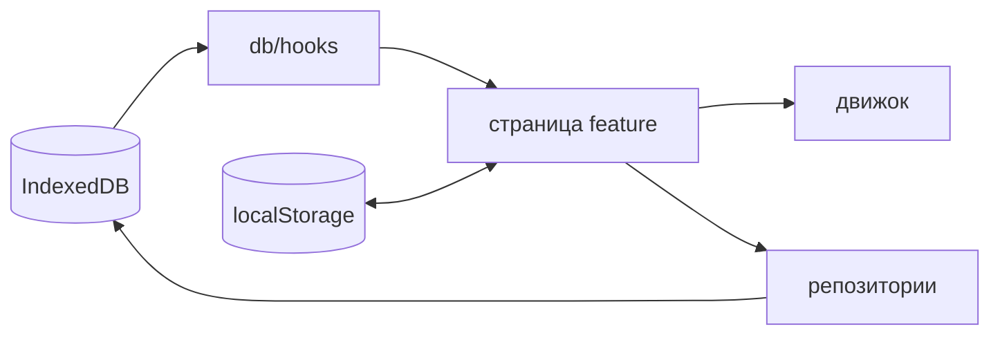

# Архитектура Flipwise

PWA с карточками: всё работает в браузере, своего бэкенда нет. Пути к коду даны от `src/`, остальные — от корня репозитория.

## Карта

| Папка                 | Что внутри                                                                 | Кто зависит                                              |
| --------------------- | -------------------------------------------------------------------------- | -------------------------------------------------------- |
| `app`                 | запуск, роутер, переходы, тема, обновление PWA, `useBack`, шторка настроек | `main.tsx`, большинство features                         |
| `design`              | UI-примитивы, пружины, тосты; зависит только от `i18n`                     | `app`, все features                                      |
| `db`                  | схема Dexie, репозитории, live-query хуки                                  | `app`, features, `lib`                                   |
| `lib`                 | чистые хелперы: сравнение ответов, импорт, бэкап, поиск, настройки         | `app`, `db`, features, `i18n`                            |
| `i18n`                | строки UI (`ru.ts`) и склонения                                            | `app`, `design`, features, `lib`                         |
| `features/decks`      | главная, страница и редактор колоды, импорт                                | `app`, `flashcards`, `hard`, `search`                    |
| `features/flashcards` | карточки со свайпом, режим предложений                                     | `app`                                                    |
| `features/learn`      | раунды Learn и их движок                                                   | `app`, `study`                                           |
| `features/test`       | тест, генератор и проверка                                                 | `app`, `study`                                           |
| `features/study`      | общее для трёх режимов                                                     | `decks`, `flashcards`, `learn`, `test`                   |
| `features/hard`       | «Трудные слова»                                                            | `app`, `decks`                                           |
| `features/search`     | поиск по всем колодам                                                      | `app`                                                    |
| `features/ai`         | примеры: промпты, провайдеры, шторки                                       | `decks`, `flashcards`, `settings`                        |
| `features/settings`   | тема, озвучка, ключи ИИ, бэкап                                             | `app`                                                    |
| `features/tts`        | озвучка через Web Speech API                                               | `ai`, `decks`, `flashcards`, `learn`, `settings`, `test` |

## Путь данных

1. `db/db.ts`: таблицы `decks`, `cards`, `progress`, `sessions` (`version(1)`).
2. Запись идёт через репозитории `db/decks.ts`, `db/progress.ts`, `db/sessions.ts`.
3. Чтение: хуки `db/hooks.ts` поверх `useCachedLiveQuery`. Dexie сам обновляет экран после записи, а кэш по ключу даёт данные в первом кадре после «назад» (`db/useCachedLiveQuery.ts`).
4. Настройки хранятся отдельно, в localStorage (`lib/storage.ts`, `useSetting`).

### Что Flashcards, Learn и Test берут из `features/study`

|                                                                       | Flashcards           | Learn    | Test            |
| --------------------------------------------------------------------- | -------------------- | -------- | --------------- |
| `useStudyRoute` (загрузка, 404, минимум карточек)                     | да, от 1             | да, от 2 | да, от 2        |
| `scope.ts` (все / незнакомые / избранные / трудные, размер)           | да                   | да       | да, без размера |
| `useStudySession` (сохранённая сессия)                                | нет                  | да       | да              |
| `StudyShell`                                                          | нет, свой `StudyBar` | да       | да              |
| `useRestartUndo` (`useSavedSession.ts`: «Отменить» после перезапуска) | да                   | да       | да              |

Раунд Flashcards живёт в памяти (`flashcards/FlashcardsPage/flashSession.ts`, `useFlashSession.ts`), в базу из раунда пишется `progress.flash`. Сессии Learn и Test лежат в `sessions` с id `${deckId}:${mode}` (`db/sessions.ts`). `study/sessionProgress.ts` решает по правилам движков, показывать ли «Продолжить» на странице колоды.

### Пример: открыл колоду и начал учить

1. `/deck/:id` → `decks/DeckPage` ждёт колоду, карточки, прогресс, трудные слова и обе сессии, потом рисует всё сразу.
2. Плитка Learn (`decks/DeckPage/ModeTiles.tsx`) ведёт на `/deck/:id/learn`; чанк грузится лениво (`app/router.tsx`).
3. `useStudyRoute({ minCards: MIN_CARDS })` (2, `study/cards.ts`) отдаёт `loading`, `missing` или `ready`.
4. `useStudySession` → `useSavedSession` читает сессию. С `?fresh=1` старая сбрасывается и предлагается «Отменить».
5. Сессии нет: `learn/LearnSetup.tsx` → выбор набора; `?scope=` важнее запомненного (`useStudyScope`, `study/StudyScopePicker.tsx`).
6. Старт (`learn/LearnPage.tsx`): `selectStudyCards` → `createLearnState` → `persist` → `saveSession`.
7. Ответ: `submitAnswer` → `recordAnswer` (прогресс карточки) + `persist` (сессия).
8. Все карточки выучены: `persist` удаляет сессию (`study/useSavedSession.ts`, `persistSession`).

## Движки

| Файл                             | Вход                                                                        | Выход                                                                                                            |
| -------------------------------- | --------------------------------------------------------------------------- | ---------------------------------------------------------------------------------------------------------------- |
| `features/learn/learnEngine.ts`  | карточки, сторона ответа, типы вопросов, id выбранных карточек; затем ответ | JSON-состояние `LearnState` (раунды до 7 карточек); `submitAnswer` → `{ state, correct, match }`                 |
| `features/test/testGenerator.ts` | карточки, `{ count, types, answerWith }`; затем ответы                      | `generateTest` → вопросы; `gradeTest` → `{ items, correct, total, percent }`                                     |
| `features/ai/prompt.ts`          | слово, перевод, языки, уровень; затем сырой ответ модели                    | `{ system, user }`; `parseExamples` → до 3 примеров или `AiError`; `parseBatchExamples` → `{ results, missing }` |

Движки с случайностью принимают `rng`. Сеть для ИИ: `ai/ExamplesSheet.tsx` / `ai/bulk.ts` → `ai/examples.ts` → `ai/providers/*`; результат пишут `updateCardExamples` и `setExamplesIfUnchanged` из `db/decks.ts`.

## Решения

- **Hash router**, потому что GitHub Pages отдаёт `index.html` только на `/` (`app/router.tsx`).
- **Данные только в IndexedDB, без бэкенда**: приложение local-first и без аккаунта (`README.md`). Почему именно так, подробнее не задокументировано; синхронизация и прокси запланированы (`ROADMAP.md`, этапы 4–5). Браузер просят не вытеснять базу (`app/App.tsx`).
- **Свой AI-ключ у каждого**, потому что сайт публичный и общий ключ в клиент класть нельзя (`ROADMAP.md`).
- **Префикс `flipwise.`**, потому что GitHub Pages держит все проекты пользователя на одном origin (`lib/storage.ts`).
- **`MAX_CARDS = 250`**, потому что все карточки колоды смонтированы на странице: 600 открываются ~0,8 с при CPU ×4 (`lib/limits.ts`). Старые большие колоды не обрезаются; причина не задокументирована.
- **Удаление с «Отменить» вместо диалога**: причина не задокументирована (правило в `CLAUDE.md`; снимок и восстановление в `db/decks.ts`).
- **Чанки `ai-*`**, потому что SDK весят ~1 МБ и нужны только при генерации: `vite.config.ts` даёт им имена `ai-*`, убирает из precache и кэширует при первом использовании; SDK грузятся через `import()` в `ai/providers/*`.
- **Без анимации на «назад»**, потому что система уже показала свой снимок, а `mode="wait"` дал бы пустой кадр (`app/RootLayout.tsx`).

## Где странно

- Цикл импортов: `app/SettingsContext.tsx` → `settings/SettingsSheet` → `AiSection.tsx` → `useKeyCheck.ts` → `ai/AiErrorBox.tsx` → `app/SettingsContext.tsx`.
- Папки зависят друг от друга: `app` ↔ features (`useBack`, `RouteError`, `SettingsContext`, `theme`), `study` ↔ `learn`/`test` (обратная сторона — `study/sessionProgress.ts`), `i18n` ↔ `lib` (`i18n/ru.ts`, `lib/languages.ts`).
- Таблицы читаются мимо `db/hooks.ts`: `study/useSessionProgress.ts`, `flashcards/FlashcardsPage/useFlashSession.ts`, `search/SearchPage.tsx`, `ai/ExamplesSheet.tsx`. `lib/backup.ts` сам пишет в базу.
- Файлы компонентов длиннее ~200 строк: `flashcards/SwipeCard.tsx` (268), `learn/LearnPage.tsx` (244), `ai/ExamplesSheet.tsx` (236), `decks/ImportSheet.tsx` (227), `flashcards/FlashcardsPage/index.tsx` (223), `decks/DeckEditor/index.tsx` (212), `learn/QuestionView/index.tsx` (210), `ai/BulkExamplesSheet.tsx` (209).
- Тест длиннее ~300 строк: `decks/DeckEditor/index.test.tsx` (311).
- Минимум карточек задан числом `2` вместо `MIN_CARDS`: `decks/DeckPage/ModeTiles.tsx`, `hard/HardStudyButtons.tsx`.
- Импорт бэкапа «заменить» стирает все данные без «Отменить» (`settings/SettingsSheet/DataSection.tsx`, `lib/backup.ts`).
- Русский текст вне `i18n/ru.ts`: название и описание демо-колоды (`db/seed.ts`).
- Hex-цвета в коде: `app/theme.ts` повторяет значения из `index.html` и `vite.config.ts`.
